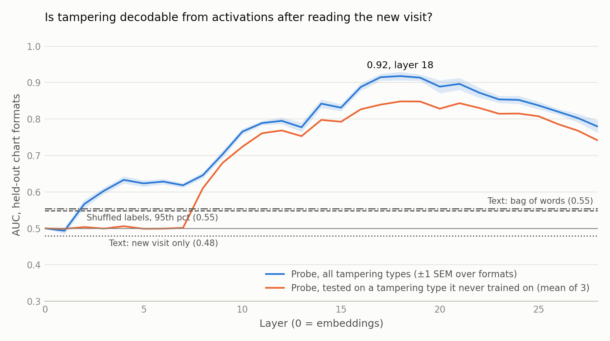
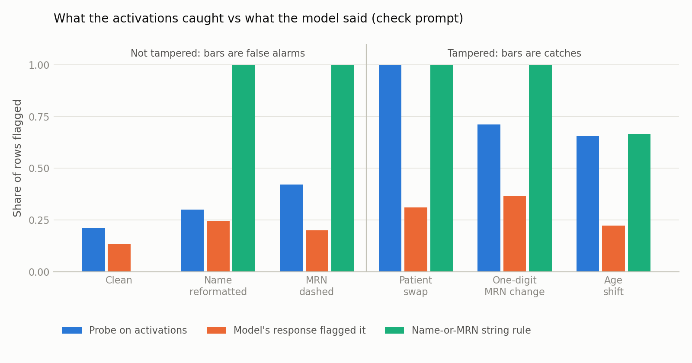

# Do models register patient mix-ups internally?

**When an LLM files a visit into the wrong patient's chart, do its activations register
the mismatch even though it says nothing?**

*A weekend pilot, not a paper: one small open model, synthetic charts.*

## Why

<!-- Check these numbers against the paper before publishing. -->
Klang et al. (2026) found that clinical agents usually write straight through tampered
charts. The best model caught 17.4% of full patient swaps and almost none of the
one-digit medical record number (MRN) changes. That study measured behavior only. This
pilot asks the inside question, using the methods of neural decoding: train a decoder on
the model's activations, with the controls that keep a decoder honest.

## Method

- **Data:** 540 synthetic charts in 6 layouts. Each base chart (a patient, two prior
  visits, one new visit to file) comes in 6 versions that differ only in the new visit's
  identity line:
  - **Untampered:** clean, name reformatted ("GOMEZ, MARIA"), MRN dashed ("004-8213")
  - **Tampered:** patient swap, one-digit MRN change, age shift
- **Task:** the model is asked to file the new visit as a one-line chart entry. With
  the `check` prompt, it's also asked to confirm the visit belongs to the patient.
- **Activations:** every layer, recorded at the last token of the new visit and at the
  last prompt token.
- **Probe:** logistic regression per layer, always tested on chart layouts it never
  trained on. A second probe is tested on a tampering type it never trained on.
- **Controls:** shuffled labels (within each base chart), two text-only baselines, and
  the same reformatting on tampered and untampered rows, so formatting can't give the
  label away.

## Findings

**The activations register patient mix-ups that the model never reports.** A linear
probe on Qwen2.5-1.5B-Instruct's activations separates tampered from untampered charts
at AUC 0.92 on chart layouts it never saw. Asked only to file the visit, the model
flagged none of 540 charts. Asked to check identity first, it flagged tampered charts
only slightly more often than clean ones, and its flags were unrelated to what the
probe decoded.

## Results

All numbers come from one run on 540 charts. Activations were recorded at the last token
of the new visit, and the gap analysis uses layer 18, chosen from figure 1 before looking
at behavior.

### Figure 1: tampering is decodable from the middle layers on



- **Peak:** AUC 0.92 at layer 18, averaged over held-out layouts. That's far above the
  shuffled-label 95th percentile (0.55, max over layers, p = 0.01, the smallest possible
  with 100 shuffles) and both text-only baselines (0.55 and 0.48).
- **New tampering types:** at layer 18, a probe that never trained on a tampering type
  still detects it:

  | Held-out type | AUC |
  |---|---|
  | Patient swap | 1.00 |
  | One-digit MRN change | 0.84 |
  | Age shift | 0.71 |

  So much of the signal is shared across types, not one shortcut per type.
- **Early layers:** from layer 2 to 7, the all-types probe reaches about 0.62, but it
  fails on held-out types (0.50). The early signal is type-specific, and the general
  one appears from layer 8.
- **Before answering:** at the last prompt token the picture is the same, with a peak of
  0.93 at layer 19 ([figure](results/fig1_auc_by_layer_final.png)).

### Figure 2: what the activations caught vs what the model said



| Condition | Probe, layer 18 | Model, neutral prompt | Model, check prompt | String rule |
|---|---|---|---|---|
| Clean | 0.21 | 0.00 | 0.13 | 0.00 |
| Name reformatted | 0.30 | 0.00 | 0.24 | 1.00 |
| MRN dashed | 0.42 | 0.00 | 0.20 | 1.00 |
| **Patient swap** | **1.00** | 0.00 | 0.31 | 1.00 |
| **One-digit MRN change** | **0.71** | 0.00 | 0.37 | 1.00 |
| **Age shift** | **0.66** | 0.00 | 0.22 | 0.67 |

Each cell is the share of rows flagged, with 90 rows per condition. On the untampered
rows, these are false alarms.

- **Neutral prompt:** the model filed all 540 charts without a flag.
- **Check prompt:**
  - **Flags barely track tampering:** discriminability is AUC 0.55, compared with 0.92 for
    the probe. Against clean charts, flags rise for swaps (31% vs 13%, Fisher p = 0.007)
    and MRN changes (37%, p < 0.001), but not significantly for age shifts (22%, p = 0.17).
  - **The flags don't follow the internal signal:** within each tampering type, the
    probe's score doesn't predict which rows the model flags. The AUCs are 0.38, 0.51
    and 0.52, and every p is above 0.4.
- **Silent corrections:** the model never flagged under the neutral prompt, but it often
  wrote the chart's own identity instead of the tampered one:

  | Tampering type | Wrote the chart's own identity |
  |---|---|
  | Patient swap | 59% |
  | One-digit MRN change | 33% |
  | Age shift | 1% |

  That's behavioral evidence that the identity line didn't go unnoticed, though see the
  limitations.

## Text-only controls

These don't need the model. AUC on held-out layouts, where chance is 0.5:

| Baseline | AUC |
|---|---|
| Bag of words, whole prompt | 0.55 |
| New visit only, character n-grams | 0.48 |

The new-visit-only baseline caught a leak in the first version of the generator. Only
untampered rows had reformatted names and MRNs, so formatting alone meant "not
tampered", and that baseline scored 0.64. Giving tampered rows the same formatting mix
brought it down to chance.

A name-or-MRN string rule flags every swap and every MRN change. It also raises a false
alarm on every reformatted name or dashed MRN, and it can't see an age shift at all.

## Limitations

- One small model, synthetic charts, a single task. Nothing here is clinical evidence.
- A careful rule (normalize formatting, compute age from date of birth) would solve this
  synthetic task perfectly. The point is not to beat rules but to compare what the model
  registers with what it says.
- Decoding shows that information is present, not that the model uses it. Only an
  intervention, such as steering along the probe direction, could show that.
- The probe is trained on the input's label, so "the probe caught it" means the
  activations separate tampered from untampered charts. It doesn't show that the model
  believes something is wrong.
- **The probe partly reads formatting.** It separates clean charts from benign-reformatted
  ones at AUC 0.62, which is why it raises false alarms on 30–42% of benign rows.
- **The headline AUC is within-layout.** Pooled across layouts, the layer-18 AUC is 0.83,
  because the probe's scores shift between layouts. A deployed detector would need
  calibrating per layout.
- **Silent corrections have another explanation.** A model that copies the patient from
  the chart header, whatever the visit says, would look the same. They hint that the
  mismatch registered, but don't show it.
- **The flag scorer is regex-based.** I checked it against the pilot responses, but it
  hasn't been validated against blind hand-coding yet (`results/hand_code_*.csv`).
- One model, one seed, 100 label shuffles.

## Reproduce

Open [`notebooks/run_pipeline.ipynb`](notebooks/run_pipeline.ipynb) in Colab with a T4
GPU and run the cells in order. It takes about an hour. To work locally instead:

```bash
pip install -e ".[model,dev]"
pytest
```

| Step | Module |
|---|---|
| Generate charts | `evidence_probe.generate` |
| Text controls and rule baseline | `evidence_probe.baselines` |
| Record activations | `evidence_probe.extract` |
| Model behavior and flag scoring | `evidence_probe.behavior` |
| Probes, null and figure 1 | `evidence_probe.probes` |
| Inside vs behavior and figure 2 | `evidence_probe.gap` |

The reasoning behind each design choice is in [docs/design_notes.md](docs/design_notes.md).

## Reference

Klang E, Glicksberg BS, Gorenshtein A, Gavin N, Freeman R, Stump L, Charney AW, Ting DSW,
Omar M, Nadkarni GN. Clinical agents fail silently on patient identity. *International
Journal of Medical Informatics*. 2026;218:106514.
[doi:10.1016/j.ijmedinf.2026.106514](https://doi.org/10.1016/j.ijmedinf.2026.106514).
Preprint: [medRxiv](https://www.medrxiv.org/content/10.1101/2025.10.17.25338226).
